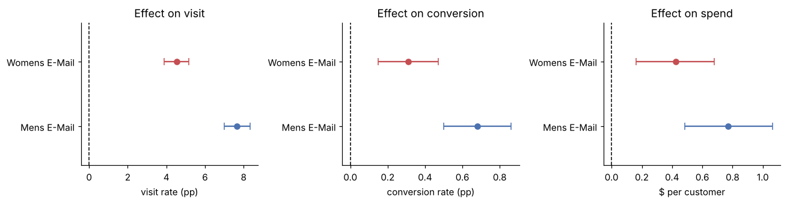
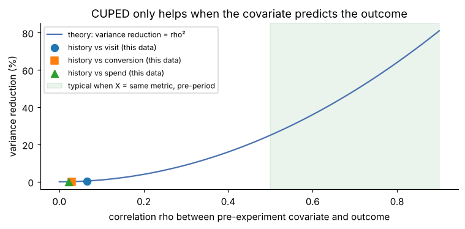
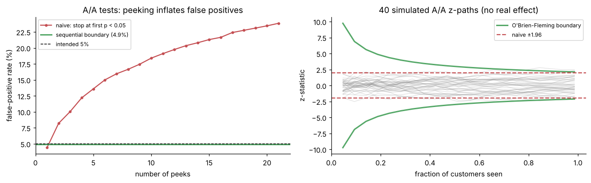
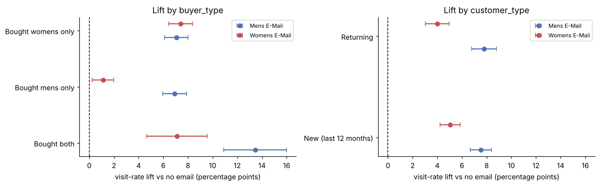
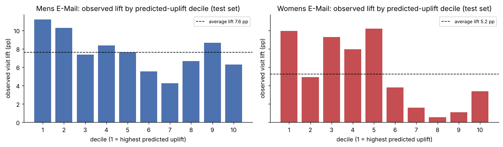

# Trustworthy Analysis of an Email Marketing Experiment

An end-to-end analysis of a real randomized experiment on **64,000 customers**: checking that the experiment can
be trusted, measuring the effects with proper uncertainty, testing variance reduction (CUPED), quantifying the
cost of "peeking" at results and fixing it with sequential testing, and deciding **who should get which email**.

**Notebook:** [`email_experiment_analysis.ipynb`](email_experiment_analysis.ipynb)

## The question

A retailer randomly split 64,000 recent customers into three equal groups: one got an email featuring men's
merchandise, one got an email featuring women's merchandise, and one got nothing. Visits, purchases and spend
were tracked for two weeks.

1. Can the experiment be trusted?
2. Did each email work, and by how much?
3. If we can only email 10,000 customers, who should get which email?

**Data:** Kevin Hillstrom's [MineThatData E-Mail Analytics Challenge](https://blog.minethatdata.com/2008/03/minethatdata-e-mail-analytics-and-data.html) (2008).

## Recommendation (TL;DR)

- **Both emails work**, and the **Mens E-Mail is the stronger default**: +7.7 percentage points in visit rate
  (10.6% → 18.3%) and +$0.77 spend per customer, roughly doubling conversion.
- **Don't send the Womens E-Mail to customers who only bought men's products before**: it lifts their visit
  rate by just ~1 pp, versus ~7 pp for women's-product buyers.
- **If only 10,000 emails can be sent**, target them with the uplift model: the targeted group showed a
  **+12.1 pp** visit lift vs **+7.7 pp** for random customers, i.e. about **1,200 vs 770 extra visits** per
  10,000 emails (~58% more).
- **Next step:** confirm the targeting rule with a new randomized test (targeted vs untargeted) before rolling
  it out, since segment and uplift findings are exploratory.

## Results

### 1. The experiment is trustworthy

| Check | Result |
|---|---|
| Sample ratio mismatch (chi-square, expected 1/3 each) | p = 0.90, group sizes consistent with the design |
| Covariate balance (past spend, recency, buyer type, new vs returning, channel, area) | Largest standardized mean difference = 0.009 (threshold 0.1) |

### 2. Both emails worked (all 6 tests significant after Holm correction)

| Email | Metric | No email | Email | Difference (95% CI) | Relative lift |
|---|---|---|---|---|---|
| Mens | Visit rate | 10.62% | 18.28% | +7.66 pp (7.00 to 8.32) | +72% |
| Mens | Conversion rate | 0.57% | 1.25% | +0.68 pp (0.50 to 0.86) | +119% |
| Mens | Spend per customer | $0.65 | $1.42 | +$0.77 ($0.49 to $1.06), bootstrap | +118% |
| Womens | Visit rate | 10.62% | 15.14% | +4.52 pp (3.89 to 5.16) | +43% |
| Womens | Conversion rate | 0.57% | 0.88% | +0.31 pp (0.15 to 0.47) | +54% |
| Womens | Spend per customer | $0.65 | $1.08 | +$0.42 ($0.16 to $0.68), bootstrap | +65% |

Spend is zero for over 99% of customers, so its confidence intervals come from a 5,000-sample bootstrap.



### 3. CUPED: an honest negative result

CUPED (Deng et al., Microsoft, 2013) reduces noise by adjusting each customer's outcome using pre-experiment
data. Its variance reduction should equal ρ², the squared correlation between the covariate and the outcome.

- Past-year spend correlates only weakly with outcomes here (ρ ≈ 0.02 to 0.07), so single-covariate CUPED cut
  variance by **under 0.5%**, matching ρ² to three decimal places.
- Using all pre-experiment columns cut visit-rate variance by **2.7%**.
- **Takeaway:** CUPED pays off when the covariate is the same metric measured before the experiment
  (ρ often 0.5 to 0.8, i.e. 25 to 64% less variance). This dataset has no pre-period visits, so check ρ first.



### 4. Peeking breaks tests; sequential testing fixes it

2,000 simulated A/A tests (control customers randomly split, so no real effect), checked after every 1,000
customers:

| Approach | False-positive rate |
|---|---|
| One look at the end | 5.5% |
| Stop at the first p < 0.05 (21 peeks) | **23.8%** |
| O'Brien-Fleming sequential boundary (calibrated by simulation) | **4.9%** |

On the real Womens E-Mail conversion effect, the sequential test detected the effect in 100% of 500 replays,
same as the single-look test, while needing on average only **57% of the data**.



### 5. Who responds

- The Mens E-Mail lifts visits by ~7 pp for every buyer type (~13 pp for customers who bought both kinds).
- The Womens E-Mail lifts visits by ~7 pp for women's-product buyers but only ~1 pp for men's-only buyers.
  The 6.3 pp difference between these segments is highly significant (p < 1e-20).
- Segment tests are Holm-corrected across all 22 comparisons.



### 6. Uplift model for targeting

A T-learner (one gradient-boosting classifier per group, trained on 70% of customers) predicts each customer's
visit uplift from each email. On the held-out 30%, customers ranked highest by predicted uplift showed larger
observed lifts, especially for the Womens E-Mail (top 3 deciles: +8.1 pp, bottom 3: +1.7 pp).

| Policy for 10,000 emails | Visit lift | Extra visits per 10,000 emails | Spend lift per customer |
|---|---|---|---|
| Random customers, Mens E-Mail | +7.7 pp | ~770 | +$0.77 |
| Top 15.6% by predicted uplift, best email each | +12.1 pp (95% CI 8.6 to 15.5) | ~1,210 | +$1.30 (95% CI $0.04 to $2.75) |

The spend difference is not conclusive: the spend CI is wide because fewer than 1% of customers buy anything.



## Methods used

- **Validity:** sample ratio mismatch check (chi-square), covariate balance (SMD, Kruskal-Wallis, chi-square)
- **Inference:** two-proportion z-tests, Welch's t-test, bootstrap confidence intervals
- **Multiple testing:** Holm correction (family-wise error rate)
- **Variance reduction:** CUPED (single covariate) and multi-covariate regression adjustment
- **Sequential testing:** Monte Carlo A/A simulations, O'Brien-Fleming alpha-spending boundary
- **Heterogeneous effects:** segment analysis with difference-in-differences tests, T-learner uplift model
- **SQL:** group-level aggregation in SQLite ([`queries.sql`](queries.sql))

## Limitations

- 2008 data from one retailer, over a single two-week window; long-term effects such as unsubscribes are not
  measured.
- Spend comes from fewer than 1% of customers, so spend estimates are noisy, especially within segments.
- Segment and uplift findings were found after the experiment, so they should be confirmed in a new test.

## Repository structure

```
├── email_experiment_analysis.ipynb   # full analysis with outputs
├── analysis.py                       # same code as a plain script (cells marked with # %%)
├── queries.sql                       # SQL aggregations
├── data/hillstrom.csv                # dataset (64,000 rows)
├── figures/                          # charts used in this README
├── results/summary.json              # key numbers produced by the notebook
└── requirements.txt
```

## How to run

```bash
pip install -r requirements.txt
jupyter notebook email_experiment_analysis.ipynb
```

Or open the notebook in Google Colab, upload `data/hillstrom.csv` into a `data` folder (or let the notebook
download it), and choose **Runtime → Run all**. The whole notebook runs in under a minute.
